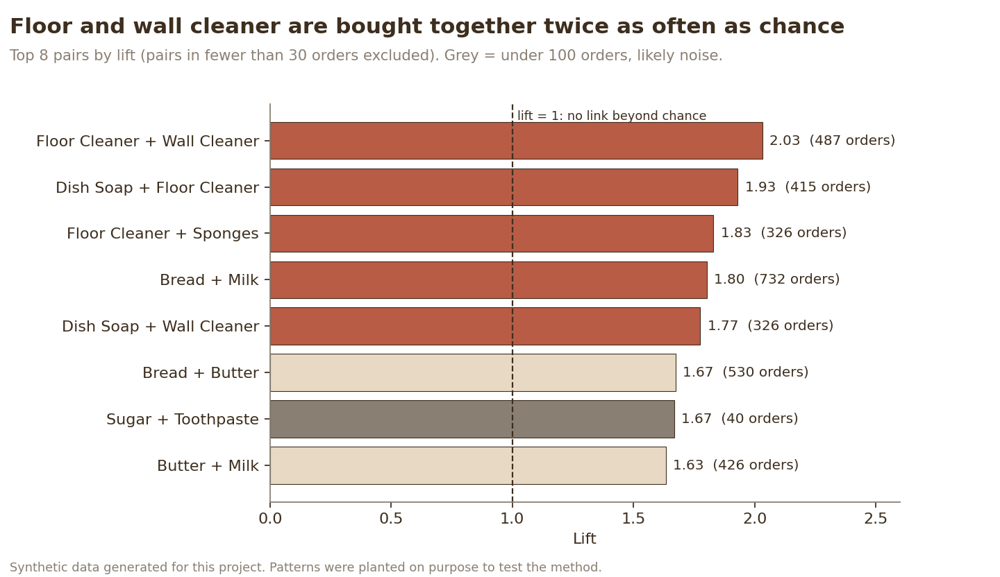

# VEETNIC: Market Basket and Sales Analysis

> **The data in this project is synthetic.** It was generated for this portfolio, and nothing here is real VEETNIC data. Two shopping patterns (breakfast, cleaning) were planted on purpose so I could test whether the analysis finds them. The results show the method works. They are not discoveries about a real shop.

## Background
As a Data Analyst at VEETNIC Enterprises (2024), I combined monthly sales from two retail systems, organized the records in Excel and used SQL to verify them. The real data belongs to the business, so this repo rebuilds the method on synthetic data that can be shared publicly. Here SQL does most of the processing and Excel is used for the summary workbook. The names POS_A and POS_B are placeholders, and the export differences between them are invented to give the cleaning step real work.

## What this project shows
The project recreates the core of that job: combine messy sales exports from two systems, clean them with documented rules, then answer two business questions.

1. **Is the business making money, and where?** Revenue, gross profit, margin and discounts by category, product and month.
2. **Which products are bought together?** A market basket analysis (support, confidence, lift) that could drive shelf placement and bundles.

## Results (synthetic data, 2024)
| | |
|---|---|
| Clean orders / sales lines | 2,401 / 8,199 |
| Revenue / gross profit | $37,847 / $11,635 (30.7% margin) |
| Discounts given | $1,188, or 3.0% of list-price revenue |
| Strongest pair | Floor Cleaner + Wall Cleaner: lift 2.03, in 20.3% of orders |
| Common pair | Bread + Milk: lift 1.80, in 30.5% of orders |
| Pairs passing the filter | 111, of which 11 have lift of 1.5 or more |

- **Breakfast** is the largest category by revenue ($15.9K); **Cleaning** has the best margin (32.7%).
- 9 of the 11 strong pairs sit inside the planted breakfast or cleaning themes, so the analysis recovered what was planted. The other 2, Sugar + Toothpaste (lift 1.67, 40 orders) and Eggs + Soap (lift 1.54, 37 orders), were never planted. They are random noise that got past the 30-order filter. This shows why a high lift on a small count should not be trusted on its own.
- Both POS systems agree after cleaning (average order value $15.78 vs $15.74; margin 30.7% vs 30.8%), which suggests the reconciliation worked.

## How it works
Start with `VEETNIC_Market_Basket_Synthetic.xlsx` for the summary, then see the SQL and code below.

| Step | File | What it does |
|---|---|---|
| 1 | `src/generate_data.py` | Generates two raw exports in different formats. POS_A uses product names, ISO dates and fractional discounts. POS_B uses product codes, DD/MM/YYYY dates and whole-percent discounts. |
| 2 | `sql/01_clean.sql` | Reconciles both into one table: matches products, converts dates and discounts, removes repeat scans and zero-quantity lines. Writes a data-quality log. |
| 3 | `sql/02_sales_performance.sql` | Revenue, gross profit, margin and discount cost by month, category and product, plus a POS_A vs POS_B comparison. |
| 4 | `sql/03_market_basket.sql` | Pair counts, support, confidence and lift. Includes a sensitivity run without unusually large orders. |
| 5 | `src/pipeline.py` | Loads the data into SQLite, runs the SQL, exports `results/`. Rebuilds the pair rules in pandas and checks they match the SQL (111 of 111 pairs). |
| 6 | `src/charts.py`, `src/build_workbook.py` | Charts, plus an Excel workbook where support, confidence and lift are live formulas. |

Run `./run_all.sh` to rebuild everything, including `veetnic.sqlite` (not stored in the repo). The seed is fixed, so the numbers are reproducible.

## Cleaning decisions
Every rule has a count in `results/dq_log.csv` and in the workbook.
- **12 repeat scans removed.** A repeat scan is an exact copy of another line: same order, product, quantity and discount. That is treated as a scanning error. If the same product appeared on separate lines with a different quantity or discount, it could be a real second purchase, so those lines would be kept and their quantities added. There were 0 such cases.
- **6 zero-quantity lines removed.** Nothing was sold.
- **9 missing discounts set to zero.** This is an assumption: no discount was given.
- **1 wholesale-style order kept.** It has all 16 products in large quantities. Keeping it moves no lift by more than 0.03, which the sensitivity run confirms.
- **Pairs seen in fewer than 30 orders are ignored.** Small counts give unstable lift.

## Definitions
- **Support:** share of all orders that contain both products.
- **Confidence:** of the orders with product A, the share that also have product B.
- **Lift:** confidence divided by how common product B is overall. Above 1 means the products appear together more than chance alone would predict.
- **Gross profit:** revenue minus product cost. It excludes rent, wages and other operating costs.

## Limits
- Synthetic data cannot show real customer behavior. Only the method is tested.
- Lift shows association, not cause. Whether a bundle would raise sales needs a real test.
- Sugar + Toothpaste (lift 1.67, 40 orders) and Eggs + Soap (lift 1.54, 37 orders) look strong but are noise; neither was planted. With counts that small I would not act on a pair without more data. A higher minimum count, or a significance test, would filter them out.
- Generated orders are spread evenly across the year, so the flat monthly trend says nothing about real seasonality.

## Recommendations the analysis would support (if the data were real)
1. Place or bundle the cleaning products together: Floor Cleaner with Wall Cleaner, Dish Soap and Sponges.
2. Keep Bread, Milk and Butter close together, since they drive the largest share of orders.
3. Review whether the 3.0% discount cost is buying extra volume.
4. Test any bundle on a small set of real orders before rolling it out.

## Tools
Excel (workbook with live formulas), SQL (SQLite), Python (pandas, matplotlib).
